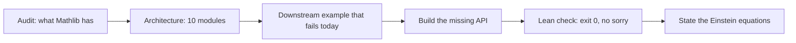
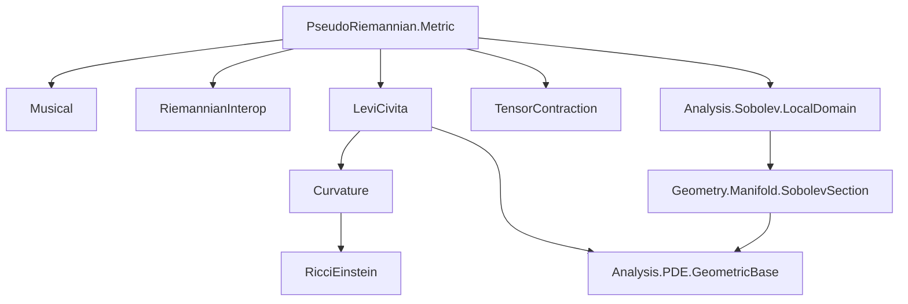

# lean-geometry-pde

[](https://github.com/richardsondx/lean-geometry-pde/actions/workflows/lean.yml)

Lean infrastructure for Lorentzian geometry and PDE.

Mathlib can describe smooth shapes and positive definite geometry. It cannot yet describe spacetime, where one direction behaves like time and three behave like space. It cannot yet describe the Einstein equations in Lean, or the function spaces that PDE proofs use on curved space.

This repo builds that missing layer. The end state is a Lean library where a researcher can write down a Lorentzian metric, compute its curvature, state the Einstein vacuum equations, state Kerr stability, and state a mass gap, with every definition checked by Lean.

This repo does not prove Kerr stability. It does not prove the Yang-Mills mass gap. It builds the floor those proofs would stand on.

## Why this exists

Mathlib is the largest library of mathematics a computer has checked, written in Lean. Every proof in it is verified by Lean's kernel, so a proof in Mathlib cannot hide a gap.

People use Mathlib to formalize real theorems. Peter Scholze's Liquid Tensor Experiment was formalized there. The polynomial Freiman-Ruzsa conjecture was formalized in weeks after the paper came out. People also use it to train AI theorem provers, to teach, and to build verified software.

Our audit checked 43 pieces of Mathlib by name. 33 exist, 9 are absent, 1 lives in a side project. The absent ones are the reason this repo exists.

Mathlib has Riemannian geometry, where every direction measures positive. It has no Lorentzian geometry, where one direction measures negative. That is the geometry of spacetime. It has no Lorentzian metric, no indefinite Levi-Civita connection, no Ricci operator for indefinite metrics. It has Sobolev spaces only in one narrow form, on flat space. It has no Sobolev spaces on domains or manifolds, no embeddings, no trace theorem, no weighted spaces, no energy estimates for the wave equation. The pull request that would add the Levi-Civita connection has sat open and unmerged.

So general relativity, the physics of black holes, has no home in the world's biggest formal math library. This repo builds that home.

Why it is worth doing: a proof checked by Lean cannot hide a gap, and the Kerr stability proof spans hundreds of pages across many papers. Infrastructure compounds. Once this layer exists, every later project starts from it instead of from zero. A Lorentzian layer is a whole missing area, and the people formalizing physics would use it.

The honest limits: this is infrastructure, not new mathematics. The theorems are known. We are making the computer check them. Mainstream mathematicians do not use Lean yet, so this matters to the formalization community first. Mathlib review is slow, and the full plan is years of work.

## How it works, in one picture



Start from a failing example, not from a list. If a step does not unblock a failing example, it does not count.

## What a failing example looks like

A researcher wants a Levi-Civita connection on a spacetime. Today, Lean says no:

```lean
import Mathlib.Geometry.Manifold.VectorBundle.Riemannian

#check @CovariantDerivative
-- error: unknown identifier 'CovariantDerivative'
```

That is the bottleneck for Phase 1. The fix is a covariant derivative API, then a Levi-Civita connection, then curvature, then Ricci. Each step is checked by Lean, and each step must make a failing example pass.

See all four failing examples in [docs/DownstreamExamples.md](docs/DownstreamExamples.md).

## Try it: the 2D showcase

The smallest working example in this repo. On two dimensions, the form `-v 0 * w 0 + v 1 * w 1` is a metric with signature (1, 1), and its matrix is `[[-1, 0], [0, 1]]` with determinant -1. Lean checks it, and a Python script checks the same numbers with exact arithmetic.

- Lean: [lean-phase1/PseudoRiemannian/Showcase.lean](lean-phase1/PseudoRiemannian/Showcase.lean)
- Python check: [lean-phase1/check_showcase.py](lean-phase1/check_showcase.py)

Run the Lean check with `lake build` inside `lean-phase1/`, and the Python check with `python3 check_showcase.py`. Both must pass. This proves the interface works on a small case. It proves nothing about curved space, the Einstein equations, or Kerr.

## See it: the sphere in 3D

The first curved case the tool proves. The unit 2-sphere in spherical coordinates, metric `g = diag(1, sin²θ)`. Lean checks that the Koszul symbols equal the standard spherical symbols, that Ricci equals the metric wherever `sinθ ≠ 0`, and that the scalar curvature is 2 at `θ = π/4`.


The red circle is `θ = π/4`, where `Γᶿ_φφ = −1/2` and `Γᵠ_θφ = 1`, so the `ΓΓ` products are genuinely nonzero. That is what makes this test discriminating: delete the `ΓΓ` sum from the Riemann components and the build fails, with `Rᶿ_φθφ` reading `0 = 1/2`.


Same pipeline, two answers. The flat plane gives `R = 0, Ric = 0, scalar = 0`. The sphere gives `Ric = g, scalar = 2`.

- Rotating video (5 seconds): [docs/showcase/sphere-rotate.mp4](docs/showcase/sphere-rotate.mp4)
- Interactive 3D, drag to rotate, with the tool pipeline: [docs/showcase-3d.html](docs/showcase-3d.html) (open it in a browser)
- The Lean file: [lean-phase1/PseudoRiemannian/SphereTestSpherical.lean](lean-phase1/PseudoRiemannian/SphereTestSpherical.lean)
- Progress per phase, with the same numbers: [docs/scoreboard.html](docs/scoreboard.html)

The tool itself is the pipeline: `Metric.lean` states what a metric is, `LeviCivita.lean` builds the connection and the curvature definitions, `SphereTestSpherical.lean` proves the sphere case, and GitHub Actions rebuilds the whole project and fails on any `sorry` on every push. The badge at the top of this page is that check, live.

This is one chart of one surface, coordinate components only. It proves nothing about general manifolds, the Einstein equations, or Kerr.

## The signature, locked

Spacetime in 4 dimensions has one time direction and three space directions:

```
g(v, v) < 0   timelike
g(v, v) = 0   null
g(v, v) > 0   spacelike
```

The lock, decided by first principles on 26 Nov 2026:

- (p, q) = (pluses, minuses)
- Lorentzian (3, 1)
- Riemannian (n, 0)

## The 10 modules



Full module list, with imports, exports, and forbids, in [docs/ARCHITECTURE.md](docs/ARCHITECTURE.md).

## How to use this repo

- Read the plan first: [PLAN.md](PLAN.md).
- Check what Mathlib already has: run the audit file.

```bash
lake env lean Audit/MathlibInventory.lean
```

It prints 33 `#check` results for names that exist, and 10 commented out lines for names that do not. Exit 0, no sorry.

- Read the architecture: [docs/ARCHITECTURE.md](docs/ARCHITECTURE.md).
- Read the decisions: [docs/BaselineDecision.md](docs/BaselineDecision.md) moves the baseline to Mathlib v4.36.0, [docs/SobolevRoutes.md](docs/SobolevRoutes.md) compares the weak derivative route with the Bessel potential route, [docs/InteropExample.md](docs/InteropExample.md) shows how the (n, 0) case converts to Mathlib's Riemannian API.
- Check the reviews: Astra's hostile review is in [handover/astra-review-phase1-planning.md](handover/astra-review-phase1-planning.md). The Gemini review prompt is in [handover/neon-review-prompt.md](handover/neon-review-prompt.md).

## Plan

- Phase 0: audit and architecture, 2 to 4 weeks
- Phase 1: Lorentzian metric, Levi-Civita, Ricci, 6 to 18 person-months
- Phase 2: Einstein equations and Ricci flat, 3 to 9 person-months
- Phase 3: Sobolev, energy estimates, PDE tools, 12 to 36 person-months
- Phase 4: Kerr metric and horizons in Lean, 6 to 18 person-months
- Phase 5: decay and stability scaffolding only, 24 to 60 person-months, no proof claimed

Total Phases 0 to 4: about 2.5 to 7 person-years.

## Rule

Lean decides. Every Lean file must compile, exit 0, no sorry, no admit. Every claim names a file, a line, and a source. A checker re-opens each one.

## Status

- Phase 0 audit: DONE, 26 Nov 2026. 33 present, 9 absent, 1 satellite.
- Signature lock: DONE, 26 Nov 2026. (p, q) = (pluses, minuses), Lorentzian (3, 1), Riemannian (n, 0).
- Phase 1 planning: DONE (v03), 27 Nov 2026, pushed 28 Nov 2026.
- Phase 1 build: GAP (v01). Modules compile, sphere test DONE in spherical form. Close-out running.
- Phase 2 Einstein: DONE narrow (v01), 28 Nov 2026, pushed, CI green. API job and divergence-free running.
- Phase 3 Sobolev first slice: DONE (v02), 28 Nov 2026, pushed, CI green. Carrier design DONE (v03). Bridge proof, embeddings, weighted running.
- Phase 4 Kerr: Ric = 0 running, verdict pending. Horizons located, proved 25 Nov 2026.
- Phase 5 stability scaffolding: running.
- Checklist: [docs/CHECKLIST.md](docs/CHECKLIST.md), 17 of 47 done, 28 Nov 2026.

## Author

Richardson Dackam, independent researcher, Toronto, Canada.
LinkedIn: https://linkedin.com/in/richardsondx
X: https://x.com/RichardsonDx

## License

MIT
